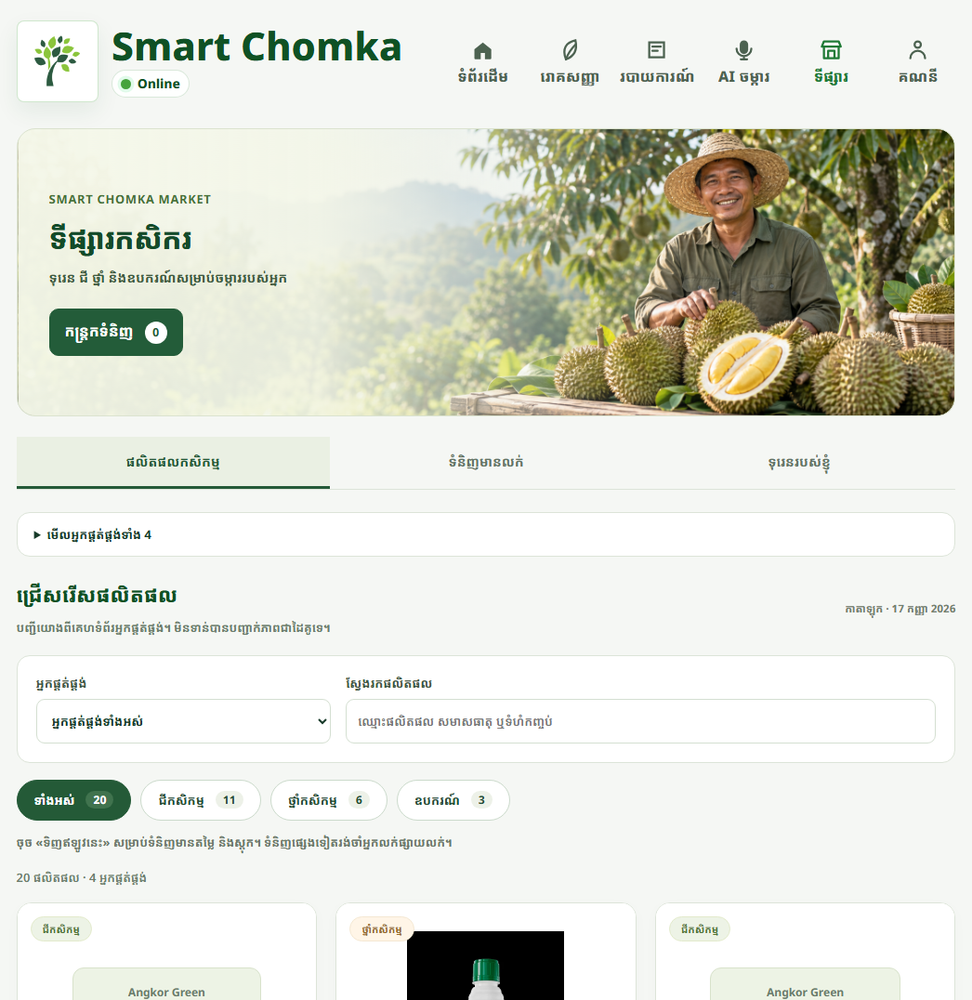
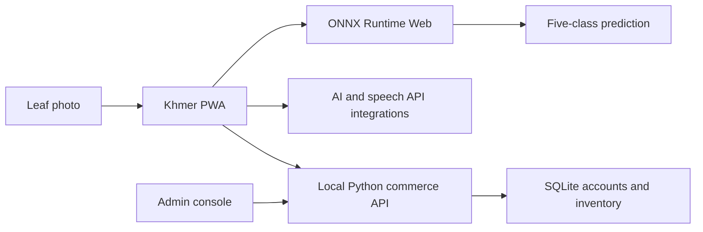

# Smart Chomka

**Machine learning for durian farming, delivered through a Khmer-language web app.**

[Live frontend demo](https://smart-chomka.vercel.app/) · [Project report](docs/PROJECT_REPORT.md) · [Model training](durianguard-ml/README.md) · [Commerce setup](smart-chomka-commerce/README.md)

Smart Chomka connects a five-class durian leaf classifier with a farmer-friendly PWA. It brings together image inspection, Khmer farming guidance, weather information, and a local commerce prototype.



## What this project demonstrates

- **Computer vision:** PyTorch transfer learning, image augmentation, model comparison, and ONNX export.
- **Browser ML:** EfficientNet-B0 inference with ONNX Runtime Web and WebAssembly.
- **Application development:** Responsive Khmer UI, photo capture/upload, disease guides, voice controls, and PWA caching.
- **Backend engineering:** Python/SQLite accounts, inventory, checkout, order history, transactional stock updates, and automated tests.

## Model results

Historical results recorded in the project presentation:

| Model | Test accuracy | Test F1 |
|---|---:|---:|
| EfficientNet-B0 | 95.61% | 95.36% |
| ResNet18 | 95.50% | 95.38% |
| MobileNetV3-Small | 90.33% | 90.22% |

The presentation reports 4,436 cleaned images. The original evaluation CSV is not included in this repository, so these are reported results, not a newly reproduced benchmark. See the [model card](docs/MODEL_CARD.md) for evidence limits and intended use.

The active model recognizes **algal leaf spot, Allocariadara attack, healthy leaf, leaf blight, and Phomopsis leaf spot**. Reference guides cover additional conditions; those are not additional classifier outputs.

## Architecture



## Run locally

Requires Python 3.11+ for the commerce server. Its core backend uses the Python standard library.

```bash
git clone https://github.com/yeabkhemra/smart-chomka.git
cd smart-chomka/smart-chomka-commerce
python server.py --port 8766
```

- Buyer app: `http://127.0.0.1:8766/`
- Admin console: `http://127.0.0.1:8766/admin/`
- On first run, create your own admin account. No default password or customer database is included.
- Catalogue entries start as drafts. Set actual prices and stock before publishing.

The server binds to localhost. It is a development server, not an internet-ready production backend. Cloud AI and speech require separately configured provider credentials; leaf classification is a separate browser-side feature.

### Train the image model

```bash
cd durianguard-ml
python -m venv .venv
# Activate .venv using your operating system's command.
python -m pip install -r requirements.txt
python -m pip install -e .
python -m durianguard.train --data-dir path/to/dataset --output-dir outputs/efficientnet_b0 --model efficientnet_b0 --epochs 25 --batch-size 32 --lr 0.0003 --class-weights
```

Download the dataset separately following the [ML README](durianguard-ml/README.md). Dataset files and training checkpoints are not bundled. The 224 × 224 ONNX inference model and its metadata are included with the app.

### Tests

```bash
cd smart-chomka-commerce
python -m unittest -v test_server.py test_accounts.py
```

Tests use temporary databases and cover authorization, profile conflicts, price/fee validation, duplicate checkout, concurrent stock reservation, cancellation, and payment-dependent order transitions.

## Repository layout

```text
smart-chomka-pwa-preview-v65/  Web frontend, ONNX model, serverless AI/speech integrations
smart-chomka-commerce/        Local commerce server, account API, database tests
durianguard-ml/               Training code, notebook, model utilities
docs/                        Project report, model card, screenshots
```

Directory names are retained so the existing local server resolves the frontend correctly.

## Current status

| Feature | Status |
|---|---|
| Web frontend | Deployed to Vercel |
| Five-class image classifier | Integrated into the browser |
| Shared accounts and commerce | Working locally; hosted API still needed |
| KHQR | Merchant QR display; payment verified manually |
| Scan reports and farmer listing drafts | Device-local |
| Automatic bank confirmation / SMS recovery | Not implemented |

The public frontend demo does **not** currently provide the local shared-account or checkout API. Do not enter real purchase information expecting a live transaction.

## Next steps

- Host the commerce API with persistent storage and HTTPS.
- Add verified account recovery and operational monitoring.
- Reproduce and publish evaluation artifacts with documented dataset splits.
- Validate performance on field photos and uncertain/out-of-distribution inputs.
- Add shared farmer listings and report synchronization.

## Data and asset notes

Training data, reference photographs, supplier product images, fonts, and runtime libraries retain their respective owners' rights. The supplier catalogue is a research reference and does not establish a commercial partnership. No blanket license is granted for third-party assets. Credentials, databases, backups, private contact data, and unrelated projects are excluded.

Image predictions are decision support, not confirmed plant-disease diagnoses. Treatment choices should be reviewed with qualified agricultural guidance and the product label.
